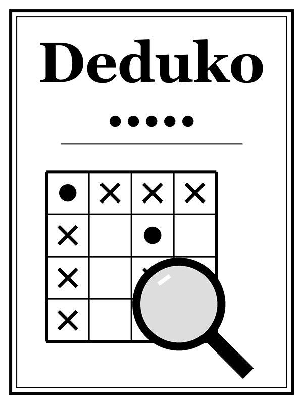
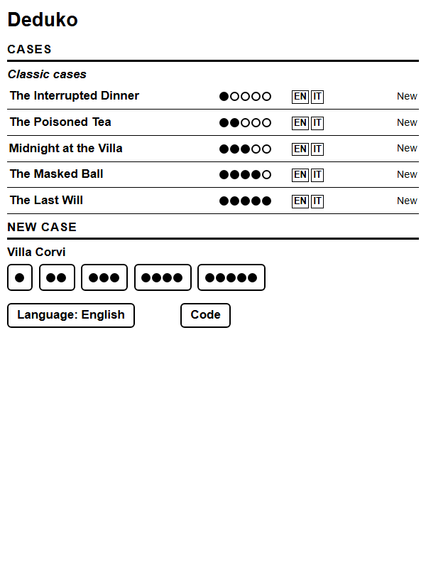
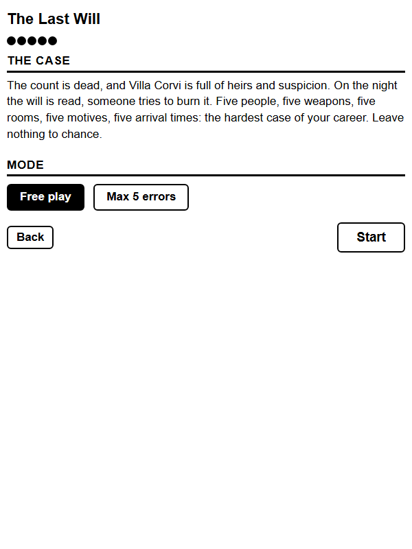
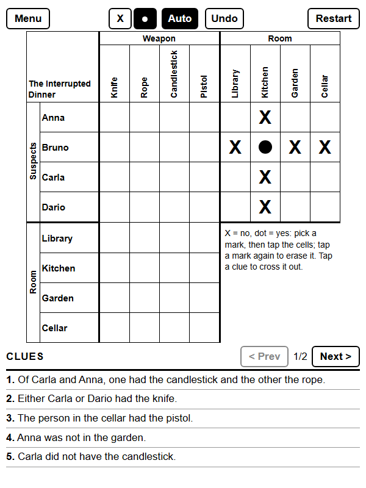
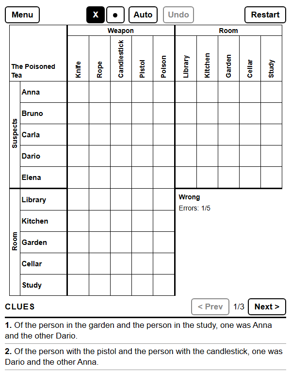

# Deduko

<p align="center">
  
</p>

<table>
  <tr>
    <td align="center"><br>Home</td>
    <td align="center"><br>Case intro and mode</td>
    <td align="center"><br>Playing, with Auto</td>
    <td align="center"><br>Error mode</td>
  </tr>
</table>

Screenshots taken at 600x800, the resolution of a 6" Kindle.

Deduko is a detective logic-grid puzzle game for jailbroken Kindle e-readers.
Each case gives you a group of suspects, a handful of facts (weapons, rooms,
motives, times of arrival) and a list of clues. Mark the grid until every
suspect is matched to exactly one item of every category: that is the
solution, and it can always be reached by pure logic, without guessing.

The game runs as a Mesquite (Kindle web app) application, is installed with
[KPM](https://github.com/KindleModding/KPM), and is playable in Italian and
English. Changes between versions are listed in [CHANGELOG.md](CHANGELOG.md).

The home screen lists the cases, each with its title, a row of five balls
(the filled ones show the difficulty), the languages it is available in
(`IT EN`) and its status (new, in progress, solved). Below them is the
"new case" section for randomly generated cases, the language button and the
Code button (to replay a generated case from its code). The
game screen shows the mark tools and Undo in the top bar, the grid below it
and the clues at the bottom. The grid is the classic staircase: the items of
the non-suspect categories are the columns (rotated labels), the suspects are
the first row band, and the other categories follow as row bands, so every
pair of categories has its own block.

## Features

- 5 fixed cases in ascending difficulty, loaded by default (pack `core`).
- Randomly generated cases on the device, one difficulty level at a time,
  from the "Villa Corvi" setting. Generated cases are saved and can be
  continued later. Each generated case has a code that recreates the same
  grid, typed on an in-app keypad.
- Two ways to play each case: free play, or error mode (at most 5 wrong
  marks, then the case starts over), chosen on the case intro screen.
- Optional auto-exclude: placing a dot crosses out the rest of its row and
  column in the block.
- Difficulty from 1 to 5 balls, set by the size of the grid (the suspects
  count as a category):

  | Balls | Categories x items | Grid (rows x columns) | Cells |
  |------:|-------------------:|----------------------:|------:|
  | 1     | 3 x 4              | 8 x 8                 | 48    |
  | 2     | 3 x 5              | 10 x 10               | 75    |
  | 3     | 4 x 4              | 12 x 12               | 96    |
  | 4     | 4 x 5              | 15 x 15               | 150   |
  | 5     | 5 x 5              | 20 x 20               | 250   |

- Every case has exactly one solution, proven offline by a brute-force search,
  and the solution is stored in the case file.
- Italian and English, chosen from the in-game language menu. Clues are
  composed at runtime by each language file, with its own grammar (Italian
  gender agreement and `di` forms included).
- Modular content: case packs can be added as a folder on the USB storage or
  as separate KPM packages, and languages can be added by adding files only.
- Progress (marks, struck clues, undo history, solved state, mode and error
  count) is saved automatically in the browser storage under the keys
  `deduko.v2.*`.
- Works offline: the game makes no network request.
- No hints, no timers, no animations: designed for e-ink.

## Requirements

- A jailbroken Kindle. KPM is needed only for install methods 2 and 3; the
  manual zip (method 1) works without it.
- A firmware with Mesquite web apps and `/var/local/appreg.db` (the same
  requirements as other Mesquite apps such as KWordle and IllusionChess).

## Install

There are three ways to install Deduko. All of them install the app to the
same place (`/var/local/mesquite/deduko`, app id `com.nardoman.deduko`), so
progress is shared and switching method or upgrading keeps it.

| Method | Needs | Status |
|---|---|---|
| 1. Manual zip | USB cable | tested on the author's Kindle |
| 2. KPM, from this repository | KPM, Wi-Fi | not tested on a device yet |
| 3. KPM, from a local file | KPM, USB cable | did not work on the author's Kindle (KPM 0.2.4) |

The files are attached to each
[release](https://github.com/nardoman/deduko/releases) (they are also built
into `dist/` by `tools/build.py base`).

### Method 1: manual zip

1. Connect the Kindle by USB and open its storage: the root is the folder
   that contains `documents`.
2. Extract `deduko_1.1.0_manuale.zip` into that root. It adds
   `documents/deduko_manuale.sh` (the library item "Deduko"),
   `deduko/pkg/` (the app and its hooks) and the empty folder
   `deduko/packs/` for extra case packs. Overwrite the files of an older
   manual install if asked.
3. Eject the Kindle and open "Deduko" from the library.
4. If it does not start, read `deduko/debug.log` on the USB storage. Every
   launch rewrites it with the date, the user, whether `sqlite3` and
   `lipc-set-prop` were found, the output of `launch.sh` and its exit code.

### Method 2: KPM, from this repository

This repository is also a KPM repository: `kpm/manifest.json` lists the
package and `kpm/packages/deduko/artifacts/` holds it. KPM reads it straight
from GitHub, no GitHub Pages needed. With Wi-Fi on, run in the Kindle search
bar:

```
;kpm add-repo https://raw.githubusercontent.com/nardoman/deduko/main/kpm/manifest.json
;kpm install deduko
```

Later versions install with `;kpm upgrade`. The install hook copies the
scriptlet `deduko.sh` to `/mnt/us/documents/`, so a "Deduko" item appears in
the library, and creates `/mnt/us/deduko/packs/` for extra case packs.

If you used method 1 before, delete `documents/deduko_manuale.sh`, or the
library shows two "Deduko" items. Progress is kept.

This method has not been tried on a device yet. If it fails, run the
install again with `;kpm -d install deduko` (debug output), open an issue with
what it prints, and use method 1.

### Method 3: KPM, from a local file

1. Copy `deduko_1.1.0_kindleany.kpkg` to the `documents` folder of the Kindle
   USB storage.
2. In the Kindle search bar, run:

   ```
   ;kpm install file:///mnt/us/documents/deduko_1.1.0_kindleany.kpkg
   ```

On the author's Kindle (KPM 0.2.4) this did not work, for a reason not yet
known.

## Launch

Open "Deduko" from the library. With the KPM package the scriptlet runs
`kpm launch deduko`; with the manual zip it runs
`/mnt/us/deduko/pkg/launch.sh` directly. The launch hook copies the app to
`/var/local/mesquite/deduko`, adds the extra case packs, registers the app id
`com.nardoman.deduko` in `appreg.db` and starts it. Close it with the close
button of the Kindle top bar.

## Uninstall

KPM package: uninstall the `deduko` package with KPM. The uninstall hook
removes the scriptlet (only if it is still the one Deduko installed), the app
copy in `/var/local/mesquite/deduko` and its registration in `appreg.db`. It
keeps your case packs in `/mnt/us/deduko/`. During an upgrade (`uninstall.sh
upgrade`) nothing is removed, so progress and the scriptlet survive.

Manual zip: delete `documents/deduko_manuale.sh` from the USB storage to
remove the library item, and the folder `deduko/` to remove the app files,
the debug log and any case packs you copied there. This leaves the app copy
in `/var/local/mesquite/deduko` and its `appreg.db` registration on the
device. To remove those too, run `cd /mnt/us/deduko/pkg && sh uninstall.sh`
from a Kindle shell before deleting the folder: run that way it removes the
app copy and the registration only (the zip has no `scriptlet/` folder, so it
leaves the library items alone).

## How to play

- Tap a case on the home screen, read the story, then tap Start.
- Each cell of the grid says whether two items go together: a suspect and an
  item in the top band, two items (for example a weapon and a room) in the
  lower bands.
- Pick a tool in the top bar (X = no, dot = yes), then tap empty cells: one
  tap writes the selected mark. The selected tool is shown inverted. Tapping
  a cell that already holds a mark erases it, whatever tool is selected.
- Auto (top bar, shown inverted when on): when you place a dot, every empty
  cell in the rest of that row and that column inside the same block gets an
  X. Cells that already hold a mark are left alone, and erasing the dot later
  does not remove the X's. One Undo removes the dot and its automatic X's
  together. The setting is remembered.
- Undo reverts the last action (a mark, an auto-exclude dot with its X's, or
  a clue strike), one step per tap. The last 50 actions are kept and survive
  closing the app. Restart clears the grid, the undo history and the error
  count (tap it twice to confirm).
- Tap a clue to strike it through once you have used it. Use the page buttons
  when the clues do not fit on one page.
- The case is solved when every suspect has exactly one dot in every block of
  the top band, every column of that band has exactly one dot, and those dots
  match the solution. The lower bands are your notes: they are saved, but the
  solved check does not read them.
- "New case" generates a random case of the chosen difficulty. Generating a
  new one replaces the saved case of that difficulty.

### Modes

The case intro screen (the story shown before Start) has a Mode row with two
buttons: Free play and Max 5 errors. The last choice is pre-selected for the
next new case.

- Free play: any mark can be placed, and no error is counted.
- Max 5 errors: a wrong mark is not placed. A wrong mark is an X on a cell
  whose answer is yes, or a dot on a cell whose answer is no, in any band.
  The status corner of the grid shows "Wrong" and the counter ("Errors:
  2/5"). Erasing a mark is never an error, and Undo does not lower the
  counter. At the 5th error the case starts over from an empty grid (struck
  clues and undo history cleared, counter back to 0, still in error mode).

The mode is fixed once the case has progress: the intro then shows it as text
(with the counter in error mode) instead of the buttons. After Restart the
case has no progress, so the next time you open it the intro offers the
buttons again.

## Case codes

Every generated case has a code made of digits only, shown in the status
corner of the grid ("Code: 113-482177") and on the solved screen. Fixed cases
have no code.

To replay a case, tap Code on the home screen, type the code on the keypad
(Del removes the last digit, the dash is added by itself) and tap OK. The
code gives the same grid in every language. If the saved case of that
difficulty is the same case and is not solved, it is resumed with its marks;
otherwise the case is generated and replaces the saved case of that
difficulty, as New case does. A mistyped code shows "Invalid code." and a code
from a newer generator shows "This code is from an unknown version of
Deduko."; in both cases the digits stay on the keypad and no grid is opened.

Layout, left to right: `V S D seed C`, shown as `VSD-<seed><C>`.

| Field | Digits | Meaning |
|---|---|---|
| V | 1 | generator version (only `1` exists) |
| S | 1 | setting code, 1-9 (Villa Corvi is `1`) |
| D | 1 | difficulty, 1-5 |
| seed | 1-10 | generator seed, 1 to 2147483646, no leading zero |
| C | 1 | Damm check digit over all the previous digits |

The check digit catches every single mistyped digit and every swap of two
adjacent digits. It cannot catch a missing digit: a code typed with one digit
left out is a different, shorter code, and about 1 time in 10 it still passes
the check and opens a different grid. If the grid is not the one you
expected, check that the code has all its digits.

New cases use 6-digit seeds (10-digit codes). Codes of cases generated by
earlier builds have other lengths and work the same way.

Pack authors: a setting gets a code by adding `"code": <1-9>` to it in
`spec.json` (a missing, malformed or already used code is ignored and the
setting stays playable without codes). A code recreates a case from the
setting's current categories, so when you change a setting's categories, give
it a new code, or old codes will produce different grids.

## Case packs

A pack is a folder `<packId>/` (id: lowercase letters, digits, `_` and `-`)
with these files:

- `pack.js`: `DEDUKO.addPack(<json>);` with the pack id, version, the fixed
  cases (categories, solution and clues in a language-neutral form) and the
  settings used for random generation.
- `text.<lang>.js`: `DEDUKO.addPackText(<json>);` with the pack name, the
  lexicon (how each suspect and item is written in that language), and the
  title and story of each case and setting. A case is shown in a language only
  when its pack has a text file for that language covering it.

The full format is in `package/app/packs/core/` (the built-in pack).

Italian lexicon entries may have an optional `lead` field, the opening of a
sentence that names who was with that item, for example `"lead": "In
giardino c'era"` for a room. The Italian "either/or" clue about two suspects
uses it ("In giardino c'era Anna o Carla."); without it the clue uses a
plainer "... era Anna o Carla." form. A setting may have an optional `code` (see
Case codes).

### Adding packs from the USB storage

Copy the pack folder to `/mnt/us/deduko/packs/<packId>/` and relaunch Deduko.
Folder and file names may only contain letters, digits, `.`, `_` and `-`;
other folders are skipped. A pack whose id is already loaded (for example a
copy of `core`) is ignored.

### Adding packs as KPM packages

Build a KPM package from a pack folder:

```
python -B tools/build.py pack <packDir> <outDir>
```

This writes `<outDir>/deduko-pack-<packId>_<version>_kindleany.kpkg`, a
package with id `deduko-pack-<packId>` that depends on `deduko` and carries
the pack in `deduko-pack/<packId>/`. Install it with KPM like Deduko itself;
its launch hook starts Deduko. Packs are loaded in this order: built-in, KPM
packages, USB folder.

### Authoring a pack

1. Write `content/<pack>/spec.json`: the pack id and version, and for each
   case its id, difficulty, seed and categories (the first category is the
   suspects; a category with `"ordered": true` lists its items in ascending
   order, e.g. times). Optional `settings` are used for random generation.
2. Generate the cases with the same engine the Kindle runs (in headless
   Chrome):

   ```
   python -B tools/gen_cases.py content/<pack>/spec.json package/app/packs/<pack>
   ```

   The output is deterministic for a given spec.
3. Write `text.it.js` and `text.en.js` next to `pack.js`.
4. Verify:

   ```
   python -B tools/verify_cases.py package/app/packs/<pack> --langs it,en --sample 20 --report <reportDir>
   ```

   It checks that each case has exactly one solution (independent brute force
   in Python), that the logic solver solves it, that every clue renders in
   every language, and writes the clue texts to `<reportDir>` so you can read
   them for grammar.

## Progress and saves

Progress is stored in the Mesquite browser storage under the keys
`deduko.v2.*`, the same keys as 1.0.0, so an upgrade keeps it:

- `deduko.v2.p.<pack>.<case>` (fixed cases) and
  `deduko.v2.gen.<pack>.<setting>.<difficulty>` (the saved generated case of
  each difficulty, with the case itself in `case`) hold `m` (marks), `s`
  (struck clues), `u` (undo history), `done`, and since 1.1.0 `e` (0 = free
  play, 1 = error mode) and `n` (error count, 0 to 4).
- `deduko.v2.auto` (`1`/`0`, auto-exclude) and `deduko.v2.errmode` (`1`/`0`,
  the mode pre-selected on the intro) are new in 1.1.0.

Saves written by 1.0.0 have no `e` and `n`: they load as free-play games with
their marks, struck clues and undo history unchanged, and a generated case
saved by 1.0.0 gets its code like any other.

## Offline

Deduko needs no network: every file it loads is local, and it makes no
network request. `config.xml` sets `internetRequired` to `no` (1.0.0 had
`yes`, copied from KWordle). What the Kindle does with this setting is not
documented; the expected effect is that the app starts without asking for a
connection. This has not been confirmed on a device yet: see step 12 of the
manual test.

## Adding a language

No code changes are needed, only new files:

1. `package/app/lang/<code>.js`: `DEDUKO.addLanguage({code, name, fields,
   strings, renderClue})`. `strings` must have the same keys as `en.js`,
   `fields` declares which lexicon fields the language needs, and
   `renderClue(clue, ctx)` builds the sentence of each clue type (`is`, `not`,
   `or`, `less`, `pair`) with that language's grammar. Use `en.js` and `it.js`
   as models.
2. `text.<code>.js` in every pack that should be playable in that language.
3. Run `python -B tools/build.py index` (on the Kindle, the launch hook
   rebuilds the index by itself) and `tools/verify_cases.py ... --langs
   it,en,<code>`, which also checks that all language files have the same
   string keys.

## Development

Requirements: Python 3 with `pyjsparser`, `websocket-client` and `Pillow`,
Google Chrome (the tools drive it headless), and a POSIX `sh` for testing the
hooks (Git for Windows `sh.exe` works). Run Python with `-B` so no
`__pycache__` lands in the project.

| Command | What it does |
|---|---|
| `python -B tools/es5check.py package/app` | ES5-only check of the app JS (Kindle WebKit is old) |
| `python -B tools/gen_cases.py content/core/spec.json package/app/packs/core` | regenerate the built-in cases |
| `python -B tools/verify_cases.py package/app/packs/core --langs it,en --sample 20 --throttle 20 --report <dir> --golden content/core/clue-golden.json` | uniqueness, solver, rendering and timing checks; `--golden` compares clue sentences with `content/core/clue-golden.json`; also checks that case codes reproduce the same case and that invalid or unknown-version codes are rejected |
| `python -B tools/build.py index` | write `package/app/generated/index.js` for desktop testing |
| `python -B tools/make_icon.py` | draw the library cover (`package/app/icon.png`, copied to `docs/images/cover.png`) and embed it in the scriptlet |
| `python -B tools/build.py base` | run the checks, build `dist/deduko_1.1.0_kindleany.kpkg` with the vendored `tools/vendor/kpm-helper.py`, and write the manual-install zip `dist/deduko_1.1.0_manuale.zip` |
| `python -B tools/e2e_ui.py --shots <dir>` | end-to-end UI test in headless Chrome at 600x800 and 1236x1648, in Italian and English (tools, tap-to-erase, auto-exclude, error mode, codes and keypad, 1.0.0 saves); screenshots go to `<dir>` |
| `python -B tools/test_launch.py` | after `build.py base`: checks the manual zip's layout and LF endings, runs `sh -n` on the scripts and `launch.sh` (with `DEDUKO_NO_LAUNCH=1`) from the extracted zip and from `package/`, and checks the kpkg version |
| `python -B tools/build.py pack <packDir> <outDir>` | build a case pack KPM package |
| `python -B tools/build.py repo` | add the current `dist/` kpkg to the KPM repository in `kpm/` (run after `base` for every release) |
| `sh -n package/launch.sh` | syntax check of a hook |

The app can be tried on a desktop by opening `package/app/index.html` in
Chrome after `build.py index`. Set `DEDUKO_SCRATCH` to choose where the tools
put temporary Chrome profiles and reports.

`launch.sh` accepts overrides for testing: `DEDUKO_TARGET`,
`DEDUKO_USB_PACKS`, `DEDUKO_KPM_PACKAGES`, and `DEDUKO_NO_LAUNCH=1` (prepare
the app folder and the index, then stop before registering and starting it).

### Generation times

Measured on the development PC in headless Chrome, 20 random cases per
difficulty from the `manor` setting (seeds 1 to 20), in milliseconds. The
throttled column slows the CPU down 20 times to approximate a Kindle.

| Balls | Grid | Unthrottled min / median / max | Throttled x20 min / median / max | Clues min / median / max |
|------:|-----:|-------------------------------:|---------------------------------:|-------------------------:|
| 1 | 3x4 | 0 / 0 / 5  | 6 / 15 / 43        | 4 / 5 / 8     |
| 2 | 3x5 | 0 / 0 / 2  | 9 / 26.5 / 129     | 6 / 7.5 / 10  |
| 3 | 4x4 | 0 / 0 / 1  | 0 / 25 / 57        | 6 / 9 / 11    |
| 4 | 4x5 | 0 / 2 / 7  | 29 / 77.5 / 280    | 9 / 10.5 / 14 |
| 5 | 5x5 | 1 / 3 / 15 | 80 / 169.5 / 1122  | 11 / 14 / 17  |

Times vary between runs, mostly in the throttled column (earlier runs
measured a throttled 5-ball maximum between 573 and 1287 ms). The fixed cases
have 6, 6, 9, 9 and 13 clues.

## Manual test on a real Kindle

The desktop tests cannot cover the device itself. Check on a Kindle:

1. Install the kpkg with KPM, or the manual zip: the install finishes
   without errors.
2. "Deduko" appears in the library (with its icon where the firmware shows
   scriptlet icons).
3. Opening it starts the app; the top bar shows "Deduko" and its close button
   closes the app.
4. Taps on cells and clues respond, one tap on an empty cell writes the
   selected tool's mark, a tap on a mark erases it, only the tapped cell
   changes, and Undo reverts one action per tap.
5. A 5-ball case (a 20 x 20 grid) is legible on a 6" screen and its cells
   (about 21 px wide at 600x800) can be tapped accurately.
6. Progress survives closing and reopening the app, and a reboot.
7. Switching language updates the menus, titles and clues.
8. Generating a case takes an acceptable time at every difficulty (note the
   time for 5 balls).
9. A pack copied to `/mnt/us/deduko/packs/<packId>/` shows up after relaunch.
10. A pack KPM package installs, its cases show up after launching Deduko, and
    they disappear after uninstalling it.
11. Upgrading Deduko with a newer kpkg keeps progress and the scriptlet.
12. Turn airplane mode on and open Deduko: it starts with no connection
    prompt and plays. If not, set `internetRequired` back to `yes` in
    `package/app/config.xml`, rebuild, and report it.
13. Uninstalling Deduko removes the library item and the app registration, and
    leaves `/mnt/us/deduko/` in place.
14. Upgrading over 1.0.0 (kpkg over kpkg, or the 1.1.0 manual zip over the
    1.0.0 one) keeps progress: cases in progress still show their marks, and
    solved cases stay solved.
15. Manual zip: after extracting it into the root, "Deduko" appears in the
    library and starts; `deduko/debug.log` is written and ends with
    `launch.sh exit code: 0`.
16. The Code keypad: every key responds to one tap, the display shows the
    dash after the third digit, Del removes one digit, and a wrong code shows
    the error message.
17. Auto-exclude and error mode on e-ink: with Auto on, a dot draws its X's
    in one redraw and one Undo removes them; in error mode a wrong mark is not
    drawn, "Wrong" and the counter appear in the status corner, and the 5th
    error restarts the case.
18. Typing on the Kindle a code generated on the PC (open
    `package/app/index.html` in Chrome, start a new case and note its code)
    gives the same grid and clues, also in the other language.

## License

MIT, see [LICENSE](LICENSE). `tools/vendor/kpm-helper.py` is from KPM and is
licensed CC0.

## Author

nardoman
